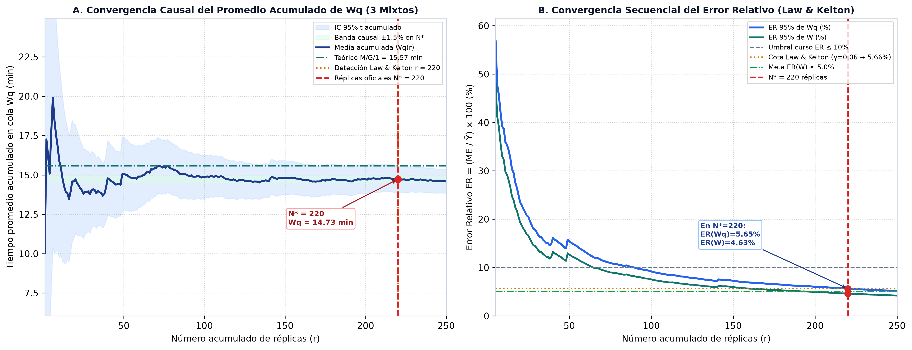
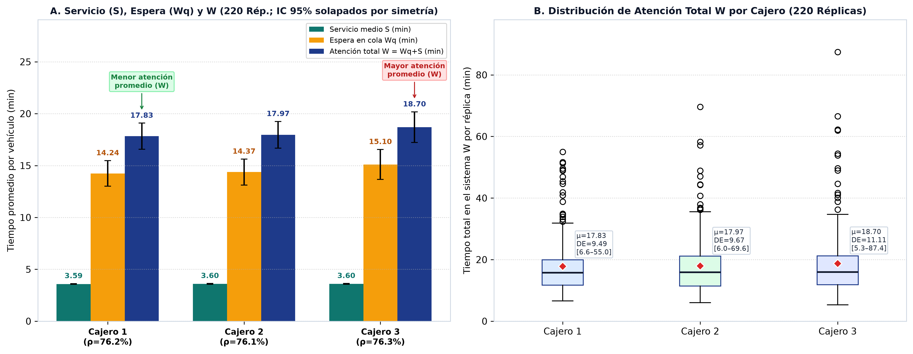
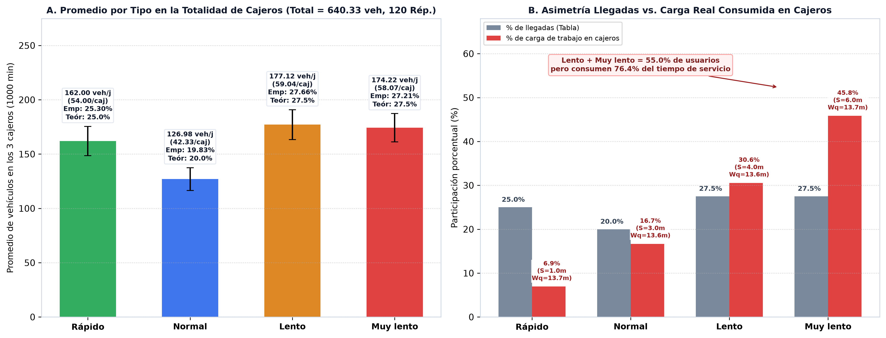
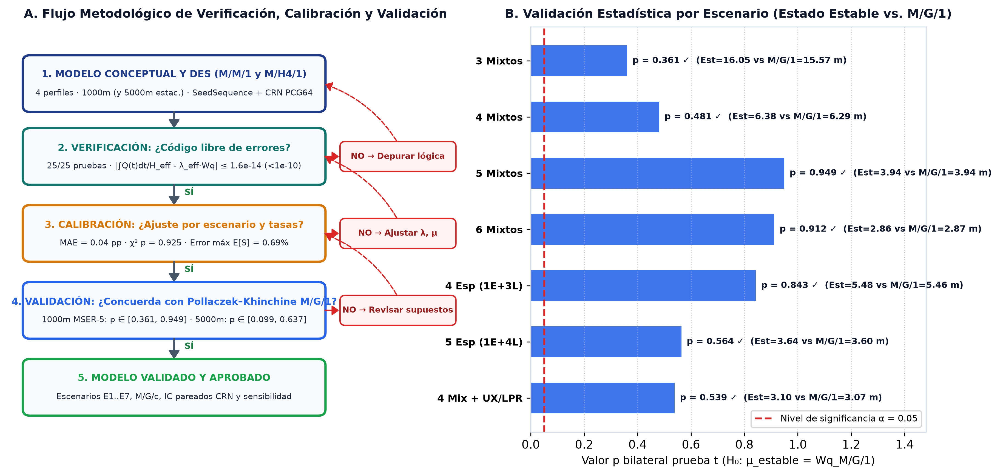
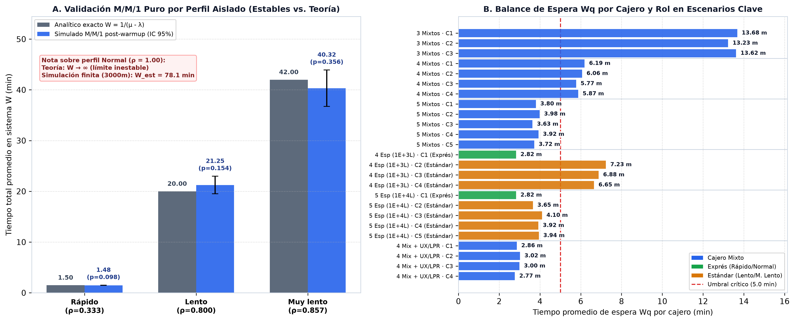

# Simulación de Colas M/M/1 y M/H4/1 (M/G/1) — Parqueaderos Centro Comercial Supercentro

[](https://colab.research.google.com/github/Camilo-Alberto-Palacio/Simulacion-Parqueadero-Supercentro-MM1/blob/main/Simulacion_Parqueadero_Supercentro_Colab.ipynb)
[-FF0000?logo=youtube&logoColor=white)](https://youtu.be/ix6PkWOdiRA)


Modelado estocástico, simulación de eventos discretos (**DES**, por sus siglas en inglés), convergencia causal de estado estable (regla secuencial de Law y Kelton), análisis de sensibilidad y eliminación del período transitorio mediante **MSER-5** para el sistema de pago de parqueaderos del **Centro Comercial Supercentro** sobre horizontes base de **$1000\text{ minutos}$** por réplica (con validación estacionaria extendida a **$5000\text{ min}$** y **$6000\text{ min}$**).

Proyecto desarrollado para la **Actividad Didáctica 2-M4 — Módulo 4 (Evidencia de Aprendizaje 4)** de la asignatura **Simulación (`PREICA2602B020045`)** en la **Institución Universitaria Digital de Antioquia (IU Digital)**.

---

## Tabla de Contenidos
1. [Consignas de la Actividad (Puntos A–E) y Alcance](#consignas-de-la-actividad-puntos-ae-y-alcance)
2. [Descripción del Problema, Parámetros y Formulación M/M/1 vs. M/H4/1](#descripción-del-problema-parámetros-y-formulación-mm1-vs-mh41)
3. [Glosario Técnico y Siglas](#glosario-técnico-y-siglas)
4. [Estructura del Repositorio](#estructura-del-repositorio)
5. [Instalación e Instrucciones de Ejecución](#instalación-e-instrucciones-de-ejecución)
6. [Resultados Principales (Estado Estable N* = 220 Réplicas)](#resultados-principales-estado-estable-n--220-réplicas)
7. [Sensibilidad Avanzada, M/G/c, H4/H4/1 y CAPEX/OPEX](#sensibilidad-avanzada-mgc-h4h41-y-capexopex)
8. [Visualizaciones Científicas (300 DPI)](#visualizaciones-científicas-300-dpi)
9. [Equipo de Trabajo (Grupo 25) y Ética](#equipo-de-trabajo-grupo-25-y-ética)
10. [Licencia](#licencia)

---

## Consignas de la Actividad (Puntos A–E) y Alcance

El proyecto da respuesta cuantitativa integral a las cinco preguntas planteadas en la guía oficial de la actividad:
* **Punto A:** Determinar cuántas réplicas ($N^*$) garantizan estado estable sobre la media e identificar qué cajero base presenta mayor y menor tiempo promedio de atención total ($W$).
* **Punto B:** Determinar el promedio diario por tipo de usuario (`Rápido`, `Normal`, `Lento`, `Muy lento`) considerando la totalidad de cajeros de la salida.
* **Punto C:** Evaluar si 3 cajeros son suficientes y proponer una estrategia argumentada comparando ampliación física, especialización de carriles, rediseño de software y reglas de asignación.
* **Punto D:** Diseñar y ejecutar un protocolo formal de Verificación, Calibración y Validación (**V&V**).
* **Punto E:** Implementar la eliminación del período transitorio inicial (*warm-up*) comparando los resultados antes y después del corte.

---

## Descripción del Problema, Parámetros y Formulación M/M/1 vs. M/H4/1

Cada salida del parqueadero del **Centro Comercial Supercentro** opera con **3 quioscos automáticos independientes** con filas propias bajo disciplina **FCFS** (*First-Come, First-Served*: primero en llegar, primero en ser atendido), sin cambio de fila ni deserción. En la configuración base paralela sin señalización observable, cada vehículo elige carril de forma aleatoria equiprobable ($1/c$, es decir, $1/3$ por posición en `E1`). El software registra la transacción al instante, pero la interacción física del usuario depende de cuatro perfiles exponenciales de velocidad:

| Tipo de Usuario | Proporción ($p_i$) | Servicio Medio ($E[S_i]$) | Tiempo Entre Llegadas ($E[IA_i]$) | Tasa $\lambda_i$ (veh/min) | Tasa $\mu_i$ (veh/min) | Factor $\rho_i = \lambda_i / \mu_i$ | Condición Aislada ($M/M/1$) |
| :--- | :---: | :---: | :---: | :---: | :---: | :---: | :--- |
| **Rápido** | `25.0 %` | `1.0 min` | `3.0 min` | `0.3333` | `1.0000` | `0.333` | Estable ($\rho < 1$) |
| **Normal** | `20.0 %` | `3.0 min` | `3.0 min` | `0.3333` | `0.3333` | `1.000` | Crítico / Inestable ($\rho \ge 1$) |
| **Lento** | `27.5 %` | `4.0 min` | `5.0 min` | `0.2000` | `0.2500` | `0.800` | Estable ($\rho < 1$) |
| **Muy lento** | `27.5 %` | `6.0 min` | `7.0 min` | `0.1429` | `0.1667` | `0.857` | Estable ($\rho < 1$) |
| **Mezcla por cajero (`E1`)** | `100.0 %` | **`3.600 min`** | **`4.650 min`** | `0.2151` ($\lambda_c$) | `0.2778` ($\mu_c$) | **`0.774`** | Estable (Alto uso) |

### Puente Teórico: ¿Por qué $M/M/1$ por perfil aislado y $M/H_4/1$ ($M/G/1$) en mezcla?
1. **Notación:** $E[IA]$ denota el tiempo medio entre llegadas (*Interarrival Time*); $\lambda_c$ es la tasa de arribo efectiva por cajero; $\mu_c = 1 / E[S]$ es la tasa de servicio por cajero; y $C_s^2 = \text{Var}(S)/E[S]^2$ es el coeficiente de variación al cuadrado del servicio.
2. **Regímenes de cola:** Cada categoría evaluada en solitario sigue una distribución de servicio exponencial única y forma una **cola $M/M/1$ exacta** (donde el perfil `Normal` con $\rho_i = 1.000$ diverge conforme crece el horizonte). En cambio, cuando los 4 perfiles comparten un mismo cajero, su tiempo de servicio pasa a ser una **mezcla hiperexponencial de orden 4 ($H_4$)** con primer momento $E[S] = 3.600\text{ min}$, segundo momento $E[S^2] = 32.70\text{ min}^2$ y $C_s^2 = 1.5231 > 1$. Bajo llegadas Poisson puras por salida ($\lambda_{\text{salida}} = 3 / 4.650 = 0.6452\text{ veh/min} \approx 645.2\text{ veh}/1000\text{ min}$, $C_a^2 = 1$), cada servidor paralelo sigue exactamente un modelo **$M/H_4/1$** (caso particular de **$M/G/1$**). Si además los intervalos entre arribos siguieran la mezcla ponderada de `E[IA_i]` ($C_a^2 = 1.2569 > 1$), el sistema correspondería a un régimen **$GI/G/1$ ($H_4/H_4/1$)**, incluido explícitamente en nuestro análisis de sensibilidad.
3. **Identidades exactas vs. aproximación $M/M/1$:** La fórmula exponencial clásica ($W_q^{\text{M/M/1}} = 12.34\text{ min}$ en `E1`) subestima la variabilidad hiperexponencial; por eso **Pollaczek–Khinchine** ($W_q^{\text{M/G/1}} = 15.57\text{ min}$, $W^{\text{M/G/1}} = 19.17\text{ min}$ en `E1`) es la identidad analítica exacta para el sistema estacionario mezclado:
   $$L_q = \lambda_c W_q, \qquad W_q^{\text{M/M/1}} = \frac{\rho}{\mu_c(1-\rho)}, \qquad W_q^{\text{M/G/1}} = \frac{\lambda_c\,\mathbb{E}[S^2]}{2(1-\rho)}, \qquad W = W_q + \frac{1}{\mu_c}$$
4. **Probabilidad de espera crítica $P(W_q > 5\text{ min})$:** La cola analítica cerrada $P(W_q > t) = \rho\,e^{-(\mu_c-\lambda_c)t}$ solo es exacta bajo servicio exponencial $M/M/1$. Debido a la cola pesada hiperexponencial $H_4$, dicha expresión subestima el riesgo real (en `E7` predice `18.90 %` frente al **`21.2 %` global / `21.9 %` peor cajero** real observado). Todas las decisiones del Punto C se evalúan sobre el cuantil empírico directo $W_q > 5\text{ min}$ del simulador $M/H_4/1$.

---

## Glosario Técnico y Siglas
* **DES** (*Discrete-Event Simulation*): simulación de eventos discretos orientada a cronología de arribos y salidas.
* **CRN** (*Common Random Numbers*): números aleatorios comunes compartidos (`Z ~ Exp(1)`, llegadas y corriente unificada de ruteo) entre escenarios para reducir la varianza de los contrastes pareados.
* **PCG64 + `SeedSequence`:** generador pseudoaleatorio moderno de NumPy (`seed = 42`) con sub-flujos independientes invariantes al prefijo (las réplicas `1..k` coinciden bit a bit cualquiera sea el límite `N*` posterior).
* **JSQ** (*Join-the-Shortest-Queue*): enrutamiento en el que el conductor observa longitudes en tiempo real (sin clarividencia) e ingresa a la fila con menor cantidad de vehículos en sistema.
* **Cola única $M/G/c$:** fila serpentina compartida que alimenta los $c$ cajeros mixtos disponibles sin bloqueo entre carriles.
* **UX / LPR / QR:** experiencia de usuario (*User Experience*) apoyada en reconocimiento automático de placas (*License Plate Recognition*) o lectura rápida QR en el cajero automático.
* **V&V / MAE / pp / gl / TOC:** Verificación, Calibración y Validación; Error Absoluto Medio; puntos porcentuales; grados de libertad ($\chi^2$); Tabla de Contenido del documento Word.

---

## Estructura del Repositorio

```text
.
├── parking_queue/                                       # Paquete modular principal en Python
│   ├── __init__.py                                      # Exportación pública (incluye replica_stream_seed)
│   ├── model.py                                         # Parámetros Supercentro, analítica M/M/1-M/G/1 y escenarios E1..E7
│   ├── simulation.py                                    # Motor DES (Law y Kelton, integral ∫Q(t)dt Little, MSER-5, JSQ, M/G/c, V&V)
│   └── visualizations.py                                # Generador de 7 figuras científicas a 300 DPI
├── tests/
│   ├── __init__.py
│   └── test_parking_queue.py                            # 25 pruebas unitarias de axiomas, regresiones Nivel B y V&V
├── results/                                             # 17 CSVs auditables y 7 figuras PNG (300 DPI)
│   ├── validacion_estacionaria_5000m.csv                # Validación estacionaria independiente (80 reps × 5000 min, 1000m warmup)
│   ├── ic_pareados_crn_escenarios.csv                   # Contrastes t pareados CRN entre políticas y simetría E1
│   └── sensibilidad_extendida_nivel_b.csv               # Barrido UX (-10%..-35%), cola única M/G/c, H4/H4/1 y pico +20%
├── main.py                                              # Script maestro experimental (exporta los 17 CSVs y 7 PNGs)
├── create_colab_notebook.py                             # Generador, pre-ejecutor y verificador cruzado automático Colab vs CSV
├── Simulacion_Parqueadero_Supercentro_Colab.ipynb       # Cuaderno Google Colab autocontenido, pre-ejecutado y con Bitácora Ética
├── generate_doc.py                                      # Generador dinámico APA 7 del informe Word (.docx)
├── Palacios_Camilo_problemaParqueadero.docx             # Informe oficial APA 7 (con TOC, Anexo A y Bitácora Ética en Anexo C)
├── GUION_VIDEO_SUSTENTACION.md                          # Guion cronometrado de sustentación (2:30 min)
├── requirements.txt
├── LICENSE
└── README.md
```

---

## Instalación e Instrucciones de Ejecución

### Opción A: Cuaderno Interactivo Autocontenido (Google Colab / Jupyter)
Haz clic en la insignia superior de **Open In Colab** o abre [`Simulacion_Parqueadero_Supercentro_Colab.ipynb`](Simulacion_Parqueadero_Supercentro_Colab.ipynb) y ejecuta `Entorno de ejecución -> Ejecutar todas`. No requiere dependencias externas a NumPy, Pandas y Matplotlib.

### Opción B: Ejecución Local Reproducible en Terminal
Requiere **Python 3.10 o superior**. Se recomienda entorno virtual (`venv`) e **importar/ejecutar en el orden exacto abajo indicado**:

```powershell
# 1. Crear y activar entorno virtual e instalar dependencias
python -m venv .venv
.\.venv\Scripts\Activate.ps1        # En Linux/macOS: source .venv/bin/activate
pip install -r requirements.txt

# 2. Ejecutar las 25 pruebas unitarias (axiomas, Little por área ∫Q(t)dt, MSER-5, Law & Kelton, H4 CRN)
python -m unittest discover -s tests -v

# 3. Correr el pipeline maestro (genera los 17 CSVs y 7 PNGs en results/)
python main.py

# 4. Regenerar entregables (¡EJECUTAR DESPUÉS DE main.py! Ambos sobrescriben los archivos de salida)
python generate_doc.py              # En Windows con Microsoft Word instalado actualiza automáticamente la TOC vía COM
python create_colab_notebook.py     # Requiere jupyter/ipykernel; pre-ejecuta el .ipynb y valida paridad 100% vs results/*.csv
```

> **Nota de reproducibilidad:** `generate_doc.py` lee dinámicamente `results/*.csv` para armar tablas e insertar figuras y luego invoca Microsoft Word (vía `pywin32` COM) para repaginar la Tabla de Contenido; en Linux/macOS genera el `.docx` completo excepto la actualización automática de campos COM (que puede actualizarse manualmente al abrir el documento). `create_colab_notebook.py` sobrescribe y ejecuta el `.ipynb` verificando automáticamente la coincidencia exacta contra `results/*.csv`.

---

## Resultados Principales (Estado Estable N* = 220 Réplicas)

### 1. Determinación Causal de Réplicas ($N^*$) por Estado Estable
* **Piloto insuficiente ($n_0 = 10$):** arrojó un error relativo ($ER = \frac{t_{0.975,n-1}\cdot (s/\sqrt{n})}{\bar{X}}\times 100\%$) de **`38.67 %`** sobre $W_q$ en `3 Mixtos` (`32.28 %` sobre $W$). Bajo la ecuación proyectiva clásica $n_{\text{prof}} = \lceil n_0 (ER_0 / ER_{\text{meta}})^2 \rceil$, se requerirían **`150`** corridas para $ER \le 10\%$, **`266`** para $ER \le 7.5\%$ y **`417`** para $ER(W) \le 5\%$.
* **Regla secuencial causal de Law y Kelton (sin *look-ahead bias*):** avanzando desde $r = 30$ evaluando únicamente los datos hasta $r$, exigimos simultáneamente precisión ajustada $ER(W_q) \le \frac{\gamma}{1+\gamma} = 5.66\%$ ($\gamma = 0.06$) y oscilación máxima $\le 1.5\%$ en la ventana móvil causal de las últimas 20 réplicas. El criterio converge exactamente en **`r = 220`**, adoptándose **$N^* = 220$ réplicas**: **$W_q = 14.73\text{ min}$** (IC 95 % *t* `[13.90, 15.56]`, **`ER(W_q) = 5.65 %`**) y **$W = 18.32\text{ min}$** (IC 95 % `[17.47, 19.17]`, **`ER(W) = 4.63 % < 5 %`**).
* **Nota sobre `results/convergencia_estado_estable_replicas.csv`:** la columna booleana `convergio_estado_estable` es una bandera global de la serie (toma `True` en todas las filas cuando la regla secuencial converge antes del tope de 250 réplicas; la primera réplica que satisface simultáneamente ambos umbrales es `r = 220`, con `wq_er_pct = 5.65 % <= 5.66 %`).



### 2. Punto A y Punto B (Escenario Base `E1`: 3 Cajeros Mixtos, $N^* = 220$)
* **Punto A — Cajero con menor y mayor atención total ($W$):**
  * **Menor atención total muestral ($W$):** `Cajero 1` (`W = 17.827 min` `[16.57–19.09]`, `Wq = 14.241 min`, `S = 3.586 min`, `ρ = 76.2%`, `P(Wq > 5 m) = 56.0%`).
  * **Intermedio:** `Cajero 2` (`W = 17.966 min` `[16.68–19.25]`, `Wq = 14.369 min`, `S = 3.596 min`, `ρ = 76.1%`, `P(Wq > 5 m) = 57.2%`).
  * **Mayor atención total muestral ($W$):** `Cajero 3` (`W = 18.702 min` `[17.22–20.18]`, `Wq = 15.104 min`, `S = 3.597 min`, `ρ = 76.3%`, `P(Wq > 5 m) = 56.9%`).
  * **Nota de agregación (media simple vs. ponderada):** el promedio no ponderado entre los 3 cajeros es `Wq = 14.571 min` (`W = 18.165 min`), mientras el promedio del sistema ponderado por clientes atendidos en `E1` es **`Wq = 14.727 min` (`14.73 min`, `W = 18.321 min`)** debido a la covarianza positiva entre volumen de arribos por jornada y congestión.
  * **Simetría estadística:** tratándose de 3 cajeros idénticos e independientes (i.i.d.) bajo ruteo equiprobable `1/3`, sus IC 95 % se solapan totalmente y las pruebas *t* pareadas entre cajeros dan `p = 0.881`, `0.367` y `0.412` ($p \ge 0.367 > 0.05$); la brecha muestral es variación Monte Carlo esperada bajo servicio $H_4$.
* **Punto B — Promedio de vehículos por tipo en la totalidad de cajeros (`645.88 ± 25.73 veh/jornada` [± desviación estándar muestral], `142,093` totales frente a `645.16` esperados Poisson):**
  * `Rápido`: **`161.92 ± 12.61`** (`53.97/caj`, `25.07%` emp. vs `25.0%` teór., `6.9%` carga teórica de servicio).
  * `Normal`: **`128.89 ± 11.82`** (`42.96/caj`, `19.96%` emp. vs `20.0%` teór., `16.7%` carga teórica).
  * `Lento`: **`177.65 ± 13.57`** (`59.22/caj`, `27.51%` emp. vs `27.5%` teór., `30.6%` carga teórica).
  * `Muy lento`: **`177.41 ± 14.61`** (`59.14/caj`, `27.47%` emp. vs `27.5%` teór., `45.8%` carga teórica).
  * *Asimetría crítica:* `Lento + Muy lento` suman `55.0%` teórico (`54.97%` empírico) de los arribos pero consumen el **`76.4%`** teórico exacto (`76.24%` empírico) de las horas-máquina de atención.

### 3. Punto C — Estrategias de Mejora (`E1..E7`, `JSQ` y Cola Única `M/G/c`)
En las variantes especializadas se separa explícitamente a los usuarios por velocidad: **`E5 (1E + 3L)`** destina 1 cajero Exprés (`E`) a `Rápido + Normal` y 3 Estándar (`L`) a `Lento + Muy lento`; **`E6 (1E + 4L)`** amplía el bloque Estándar a 4 servidores. En todos los escenarios evaluamos 5 reglas cuantitativas fijadas por el Grupo 25 sobre el régimen estacionario: `Wq <= 5 min` (`< 3` óptimo), `W <= 8 min`, ocupación del servidor más cargado `45%–85%`, `Lq < 3` por cajero y `P(Wq > 5 min) <= 20%` en el peor cajero (referido siempre a espera en fila).

| Escenario | Cajeros | $W_q$ (IC 95 % *t*) | Peor Caj. $W_q$ | Total $W$ | Teór. $M/G/1$ | $W_q$ JSQ | Cola Única $M/G/c$ | Uso $\bar{\rho} / \rho_{\text{caj}}$ | $P(W_q>5\text{m})$ Global / Peor Caj. |
| :--- | :---: | :---: | :---: | :---: | :---: | :---: | :---: | :---: | :---: |
| **E1: 3 Mixtos (Base)** | `3` | `14.73 m` `[13.90–15.56]` | `15.10 m` | `18.32 m` | `15.57 m` | `4.95 m` | `4.03 m` | `76.2% / 76.3%` | `57.0%` / `57.2%` |
| **E2: 4 Mixtos** | `4` | `6.18 m` `[5.94–6.42]` | `6.48 m` | `9.77 m` | `6.29 m` | `1.15 m` | `0.67 m` | `57.7% / 57.8%` | `34.8%` / `35.0%` |
| **E3: 5 Mixtos** | `5` | `3.85 m` `[3.73–3.97]` | `3.93 m` | `7.45 m` | `3.94 m` | `0.37 m` | `0.16 m` | `46.2% / 46.6%` | `24.5%` / `25.4%` (`2.7%` JSQ) |
| **E4: 6 Mixtos (`REDUNDANTE`)** | `6` | `2.82 m` `[2.74–2.91]` | `2.91 m` | `6.42 m` | `2.87 m` | `0.12 m` | `0.04 m` | `38.6% / 38.7%` | `18.6%` / `18.7%` |
| **E5: 4 Esp (1E+3L)** | `4` | `5.35 m` `[5.12–5.58]` | `7.34 m` | `8.94 m` | `5.46 m` | `2.46 m` | `—` | `57.7% / 58.7%` | `30.8%` / `39.0%` |
| **E6: 5 Esp (1E+4L)** | `5` | `3.57 m` `[3.45–3.69]` | `4.15 m` | `7.16 m` | `3.60 m` | `1.63 m` | `—` | `46.2% / 55.0%` | `23.3%` / `25.6%` |
| **E7: 4 Mix + UX/LPR** | `4` | **`3.05 m`** `[2.95–3.15]` | **`3.19 m`** | **`5.96 m`** | `3.07 m` | **`0.44 m`** | **`0.22 m`** | `46.8% / 46.9%` | `21.2%` / `21.9%` (**`3.1%` JSQ; `0.7%` $M/G/c$**) |

* **¿Son suficientes 3 cajeros?** **No.** El sistema base `E1` presenta `Wq = 14.73 min`, `W = 18.32 min`, utilización pico intradiaria de `83.0 %` (`76.3 %` media en el peor servidor) y **`57.0 %` global (`57.2 %` peor servidor)** esperando más de 5 minutos.
* **Estrategia recomendada (Grupo 25):** Ampliar a **4 cajeros mixtos + mejora UX/LPR en software (`E7`)** (captura automática de placa LPR/QR que recorta `25 %` la interacción de usuarios Lentos y Muy lentos). Con llegadas aleatorias independientes logra **`Wq = 3.05 min`** y el menor tiempo total del estudio (**`W = 5.96 min`** frente a `6.42 min` en 6 cajeros). `E4 (6 Mixtos)` cumple las metas de espera pero resulta **`REDUNDANTE`** (`Subutilizado < 45 %`, `38.7 %` en el servidor más cargado y `61.4 %` de ocio promedio). Como en modo aleatorio independiente `E7` retiene `21.9 %` ($>20\%$) en el peor carril, recomendamos implementarlo con **señalización JSQ** (`Wq = 0.44 min`, `P(>5 m) = 3.1 %`) o **fila única serpentina $M/G/c$** (`Wq = 0.22 min`, `0.7 %` peor servidor). Sin intervención en software, la alternativa puramente física es **5 Mixtos (`E3`) + JSQ** (`Wq = 0.37 min`, `2.7 %`).

### 4. Puntos D y E — Verificación, Calibración, Validación y Eliminación del Transitorio (MSER-5)
* **Verificación:** `25/25` pruebas unitarias OK; Ley de Little auditada por integración continua de área $|\frac{1}{H_{\text{eff}}}\int Q(t)\,dt - \lambda_{\text{eff}}\,W_q| \le 1.60 \times 10^{-14} < 10^{-10}$ en todas las `220 × 7` corridas (paralelas y JSQ), más verificación cruzada automática del cuaderno Colab vs. CSVs.
* **Calibración:** **`MAE = 0.04 pp`**, bondad de ajuste $\chi^2 = 0.470$ (`gl = 3, p = 0.925 > 0.05`) y error relativo máximo en servicio de **`0.69 %`**.
* **Validación:** Pruebas *t* bilaterales frente a Pollaczek–Khinchine $M/G/1$ en las que no se rechaza $H_0$ ($\alpha = 0.05$) en los 7 escenarios tanto a `1000 min` post-MSER-5 (**$p \in [0.361, 0.949]$**, `E1: p = 0.361`) como en corridas estacionarias largas de `5000 min` (`80` réplicas, `1000 min` descartados: **$p \in [0.099, 0.637]$**); además, validación $M/M/1$ aislada a `6000 min` (`30 %` warm-up: `Rápido p = 0.832`, `Lento p = 0.360`, `Muy lento p = 0.066`, y `Normal` crece `2.96×` de `41.6` a `123.3 min`).
* **Eliminación del período transitorio (Punto E, MSER-5):** Sin truncar llegadas posteriores a $k = 550$, la regla clásica **MSER-5** ($b = 5$, $d \in [4, 55]$) detecta el corte en **`k* = 176` vehículos (`~270.8 min`)** en `3 Mixtos`: la espera promedio sube **`+8.95 %` (`+9.0 %`)** desde **`14.73 min` (Antes)** hasta **`16.05 min` (Después — estado estable)** frente a `15.57 min` $M/G/1$ (subestimación inicial de **`8.21 %`**). En servidores individuales el sesgo oscila entre `6.34 %` (`14.24 → 15.20 m`) y `9.38 %` (`15.10 → 16.67 m`) (incremento de `6.77 %` a `10.36 %`); en `E2..E7`, `k* ∈ [26, 76]` con subestimación entre `1.39 %` y `3.16 %`.

---

## Sensibilidad Avanzada, M/G/c, H4/H4/1 y CAPEX/OPEX

* **Contrastes pareados CRN (`N* = 220`):** `E7` supera a `E2` por $\Delta W_q = -3.133\text{ min}$ (IC 95 % `[-3.28, -2.99]`, $p < 10^{-105}$) y a `E3` por $-0.804\text{ min}$ (`[-0.87, -0.74]`, $p < 10^{-65}$); frente a `E4` difiere en $+0.224\text{ min}$ en cola (`[0.17, 0.28]`), pero gana en permanencia total `W` (`5.96` vs `6.42 min`).
* **Barrido de efectividad UX/LPR (`-10 %` a `-35 %`, `N* = 220` reps en 4 Mixtos):** incluso si la mejora LPR/QR lograra apenas **`-15 %`** en vez de `-25 %`, con señalización **JSQ** conserva **`Wq = 0.66 min`** (`P(>5 m) = 4.7 %` peor servidor); con `-30 %`, incluso sin JSQ alcanza `Wq = 2.63 min` y `P(>5 m) = 19.2 % <= 20 %`.
* **Llegadas hiperexponenciales $H_4/H_4/1$ ($C_a^2 = 1.257$, CRN acoplado) y pico de demanda ($+20\%$ en $\lambda$, `N* = 220` reps):** bajo ráfagas $H_4/H_4/1$, `E1` sube a `Wq = 14.96 min` (`> 14.73 m` Poisson), mientras `E7 + JSQ` mantiene **`Wq = 0.52 min`** (`3.7 %` peor servidor sobre 5 m); ante un incremento sostenido de $+20\%$ en demanda, `E7 + JSQ` sostiene **`Wq = 0.80 min`** (`5.7 %` peor servidor sobre 5 m).
* **Comparativa ilustrativa CAPEX / OPEX (por salida):**

| Alternativa | Alcance de inversión | CAPEX referencial | OPEX relativo | Desempeño esperado |
| :--- | :--- | :---: | :---: | :--- |
| **E3: 5 Mixtos** | +2 quioscos físicos | Alto (~USD 24k–36k) | Medio (2 equipos extra) | `Wq = 3.85 m` (`0.37 m` JSQ; `0.16 m` $M/G/c$) |
| **E4: 6 Mixtos (`REDUNDANTE`)** | +3 quioscos físicos | Muy alto (~USD 36k–54k) | Alto (`61.4 %` ocio) | `Wq = 2.82 m` (`W = 6.42 m`) |
| **E7: 4 Mix + UX/LPR (+JSQ)** | +1 quiosco + módulo LPR/QR + pantalla | Moderado (~USD 16k–23k) | Bajo (1 equipo + software) | `Wq = 3.05 m` (`0.44 m` JSQ; `0.22 m` $M/G/c$; `W = 5.96 m`) |

---

## Visualizaciones Científicas (300 DPI)

| Desempeño por Cajero (Punto A) | Usuarios por Tipo y Carga (Punto B) |
| :---: | :---: |
|  |  |
| **Estrategias de Mejora (Punto C)** | **Proceso V&V y Validación (Punto D)** |
|  |  |
| **Eliminación del Transitorio MSER-5 (Punto E)** | **Validación M/M/1 Aislada 6000m y Balance** |
|  |  |

---

## Equipo de Trabajo (Grupo 25) y Ética

* **Adriana Andrea Agudelo Agudelo**
* **Camilo Alberto Palacios Turriago**
* **Juan Daniel Pulgarin García**
* **Ruben Dario Jaramillo Cervantes**

**Docente:** Dr. Julián Andrés Loaiza López  
**Asignatura:** Simulación — `PREICA2602B020045`  
**Institución:** Institución Universitaria Digital de Antioquia (IU Digital) — Facultad de Ingeniería  
**Sede y Fecha:** Medellín, Antioquia · Noviembre de 2026  
**Video de Sustentación (YouTube, 2:33 min):** [Ver pitch oficial en YouTube](https://youtu.be/ix6PkWOdiRA) (`https://youtu.be/ix6PkWOdiRA`)  
**Bitácora Ética de IA (*Usa–Modifica–Crea*):** documentada íntegramente en el **Anexo C** de [`Palacios_Camilo_problemaParqueadero.docx`](Palacios_Camilo_problemaParqueadero.docx) y en la **Sección 6** de [`Simulacion_Parqueadero_Supercentro_Colab.ipynb`](Simulacion_Parqueadero_Supercentro_Colab.ipynb).

---

## Licencia

Distribuido bajo la licencia **MIT**. Consulta [`LICENSE`](LICENSE) para más información.
