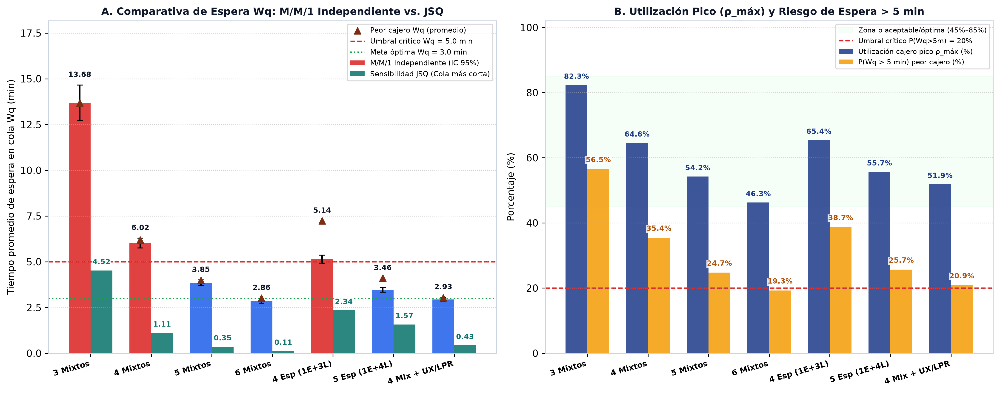
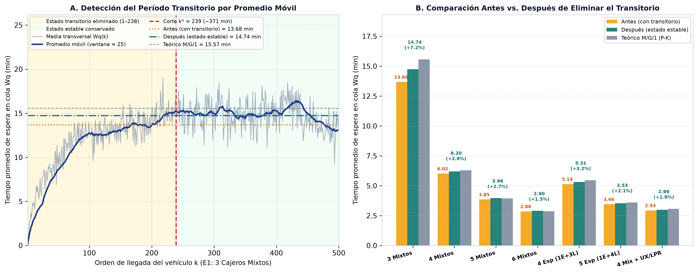

# Simulación de Colas Independientes M/M/1 y M/G/1 — Parqueaderos Centro Comercial Supercentro


Modelado estocástico, simulación de eventos discretos (DES), análisis de estado estable y eliminación del período transitorio para el sistema de pago de parqueaderos del **Centro Comercial Supercentro** sobre horizontes de **$1000\text{ minutos}$** por réplica.

Proyecto desarrollado para la **Actividad Didáctica 2-M4 — Módulo 4 (Evidencia de Aprendizaje 4)** de la asignatura **Simulación (`PREICA2602B020045`)** en la **Institución Universitaria Digital de Antioquia (IU Digital)**.

---

## Tabla de Contenidos
1. [Descripción del Problema y Parámetros Oficiales](#descripción-del-problema-y-parámetros-oficiales)
2. [Formulación Teórica M/M/1 y M/G/1](#formulación-teórica-mm1-y-mg1)
3. [Estructura del Repositorio](#estructura-del-repositorio)
4. [Instalación e Instrucciones de Ejecución](#instalación-e-instrucciones-de-ejecución)
5. [Resultados Principales (Estado Estable N* = 120 Réplicas)](#resultados-principales-estado-estable-n--120-réplicas)
6. [Visualizaciones Científicas (300 DPI)](#visualizaciones-científicas-300-dpi)
7. [Equipo de Trabajo (Grupo 25)](#equipo-de-trabajo-grupo-25)
8. [Licencia](#licencia)

---

## Descripción del Problema y Parámetros Oficiales

Cada salida del parqueadero del **Centro Comercial Supercentro** cuenta con **3 cajeros automáticos** independientes con filas propias (disciplina FCFS, sin cambio de fila ni deserción), modelados como sistemas **$M/M/1$**. La velocidad de procesamiento del software es inmediata por evento, pero el tiempo de interacción del usuario al digitar la placa y pagar depende de su perfil exponencial:

| Tipo de Usuario | Proporción | Media de Servicio ($E[S]$) | Media de Llegada ($E[IA]$) | Tasa $\lambda_i$ (veh/min) | Tasa $\mu_i$ (veh/min) | Factor $\rho_i$ | Condición Aislada |
| :--- | :---: | :---: | :---: | :---: | :---: | :---: | :--- |
| **Rápido** | `25.0 %` | `1.0 min` | `3.0 min` | `0.3333` | `1.0000` | `0.333` | Estable ($\rho < 1$) |
| **Normal** | `20.0 %` | `3.0 min` | `3.0 min` | `0.3333` | `0.3333` | `1.000` | Crítico / Límite ($\rho = 1$) |
| **Lento** | `27.5 %` | `4.0 min` | `5.0 min` | `0.2000` | `0.2500` | `0.800` | Estable ($\rho < 1$) |
| **Muy lento** | `27.5 %` | `6.0 min` | `7.0 min` | `0.1429` | `0.1667` | `0.857` | Estable ($\rho < 1$) |
| **Mezcla por cajero (Base)** | `100.0 %` | **`3.600 min`** | **`4.650 min`** | `0.2151` | `0.2778` | **`0.774`** | Estable (Alto uso) |

---

## Formulación Teórica M/M/1 y M/G/1

* **Demanda total conservada por salida:** $\lambda_{\text{salida}} = 3 / 4.650 = 0.6452\text{ veh/min}$ ($\approx 645.2\text{ vehículos / }1000\text{ min}$).
* **Hiperexponencialidad de la mezcla:** $E[S] = 3.600\text{ min}$, $E[S^2] = 32.70\text{ min}^2 \implies C_s^2 = 1.5231 > 1$.
* **Identidades analíticas y cota Pollaczek–Khinchine $M/G/1$:**
  $$L_q = \frac{\rho^2}{1-\rho}, \qquad W_q^{\text{M/M/1}} = \frac{\rho}{\mu_c(1-\rho)}, \qquad W_q^{\text{M/G/1}} = \frac{\lambda_c\,\mathbb{E}[S^2]}{2(1-\rho)}, \qquad W = W_q + \frac{1}{\mu_c}$$
* En la base de 3 cajeros (`E1`): $\rho = 77.42\%$, $W_q^{\text{M/M/1}} = 12.34\text{ min}$, $W_q^{\text{M/G/1}} = 15.57\text{ min}$ y $W^{\text{M/G/1}} = 19.17\text{ min}$.

---

## Estructura del Repositorio

```text
.
├── parking_queue/                                       # Paquete modular principal en Python
│   ├── __init__.py                                      # Exportación pública
│   ├── model.py                                         # Parámetros Supercentro, analítica M/M/1-M/G/1 y escenarios E1..E7
│   ├── simulation.py                                    # Motor DES (N* estado estable, warm-up, JSQ y protocolo V&V)
│   └── visualizations.py                                # Generador de 7 figuras científicas a 300 DPI
├── tests/
│   ├── __init__.py
│   └── test_parking_queue.py                            # 16 pruebas unitarias (Little, t-Student, Chi2, N*, warm-up, V&V)
├── results/                                             # 14 CSVs auditables y 7 figuras PNG (300 DPI)
├── main.py                                              # Script maestro experimental
├── create_colab_notebook.py                             # Generador, ejecutor y verificador cruzado de Colab
├── Simulacion_Parqueadero_Supercentro_Colab.ipynb       # Cuaderno Google Colab autocontenido y pre-ejecutado
├── generate_doc.py                                      # Generador dinámico APA 7 del informe Word (.docx)
├── Palacios_Camilo_problemaParqueadero.docx             # Informe oficial APA 7 (con TOC y numeración actualizada)
├── GUION_VIDEO_SUSTENTACION.md                          # Guion cronometrado de sustentación (2:30 min)
├── requirements.txt
├── LICENSE
└── README.md
```

---

## Instalación e Instrucciones de Ejecución

### Opción A: Cuaderno Interactivo Autocontenido (Google Colab / Jupyter)
Abre `Simulacion_Parqueadero_Supercentro_Colab.ipynb` en Google Colab o Jupyter y ejecuta `Entorno de ejecución -> Ejecutar todas`. No requiere paquetes externos adicionales a NumPy, Pandas y Matplotlib.

### Opción B: Ejecución Local Reproducible en Terminal
```bash
# 1. Instalar dependencias
pip install -r requirements.txt

# 2. Ejecutar las 16 pruebas unitarias de verificación matemática y V&V
python -m unittest discover -s tests -v

# 3. Correr el pipeline completo (N*, 120 réplicas × 7 escenarios, JSQ, V&V, warm-up y 7 gráficas)
python main.py

# 4. Regenerar informe Word APA 7 (.docx) y cuaderno Google Colab pre-ejecutado
python generate_doc.py
python create_colab_notebook.py
```

---

## Resultados Principales (Estado Estable N* = 120 Réplicas)

### 1. Determinación de Réplicas ($N^*$) por Estado Estable
* Con piloto inicial $n_0 = 10$, el Error Relativo sobre $W_q$ en `3 Mixtos` alcanza **`44.01%`** (`n_prof = 194` para $ER \le 10\%$).
* Aplicando la convergencia del promedio acumulado sobre `1..150` réplicas, la media ingresa de forma sostenida en la banda asintótica $\pm 2\%$ con $ER \le 7.5\%$ en `r = 112`, adoptándose **$N^* = 120$ réplicas** (`Wq = 13.68 min`, IC 95 % *t* `[12.71, 14.66]`, **`ER(Wq) = 7.10%`**, **`ER(W) = 5.72%`**).


### 2. Punto A y Punto B (Escenario Base: 3 Cajeros Mixtos, $N^* = 120$)
* **Punto A — Cajero con menor y mayor atención:**
  * **Menor atención total ($W$):** `Cajero 2` (`W = 16.839 min` `[15.58–18.10]`, `Wq = 13.231 min`, `S = 3.608 min`, `ρ = 75.8%`).
  * **Mayor atención total ($W$):** `Cajero 1` (`W = 17.287 min` `[15.21–19.37]`, `Wq = 13.680 min`, `S = 3.607 min`, `ρ = 75.7%`).
  * **Intermedio:** `Cajero 3` (`W = 17.224 min` `[15.67–18.78]`, `Wq = 13.621 min`, `S = 3.603 min`, `ρ = 75.9%`).
* **Punto B — Promedio de vehículos por tipo en la totalidad de cajeros (`640.33 veh/jornada`, `76,839` totales):**
  * `Rápido`: **`162.00 ± 13.48`** (`54.00/caj`, `25.30%` emp. vs `25.0%` teór., `6.9%` carga de servicio).
  * `Normal`: **`126.98 ± 10.48`** (`42.33/caj`, `19.83%` emp. vs `20.0%` teór., `16.7%` carga).
  * `Lento`: **`177.12 ± 13.69`** (`59.04/caj`, `27.66%` emp. vs `27.5%` teór., `30.6%` carga).
  * `Muy lento`: **`174.22 ± 13.07`** (`58.07/caj`, `27.21%` emp. vs `27.5%` teór., `45.8%` carga).
  * *Asimetría crítica:* `Lento + Muy lento` son el `55.0%` de las visitas pero consumen el **`76.4%`** del tiempo de servicio.

### 3. Punto C — Estrategias de Mejora (`E1..E7` y Sensibilidad JSQ)

| Escenario | Cajeros | $W_q$ (IC 95 % *t*) | Peor Cajero $W_q$ | Total $W$ | Teór. $M/G/1$ | $W_q$ JSQ | Uso $\bar{\rho} / \rho_{\max}$ | $P(>5\text{m})$ Peor Caj. |
| :--- | :---: | :---: | :---: | :---: | :---: | :---: | :---: | :---: |
| **E1: 3 Mixtos (Base)** | `3` | `13.68 m` `[12.71–14.66]` | `13.68 m` | `17.29 m` | `15.57 m` | `4.52 m` | `75.8% / 82.3%` | `56.5%` |
| **E2: 4 Mixtos** | `4` | `6.02 m` `[5.75–6.29]` | `6.19 m` | `9.62 m` | `6.29 m` | `1.11 m` | `57.4% / 64.6%` | `35.4%` |
| **E3: 5 Mixtos** | `5` | `3.85 m` `[3.70–4.00]` | `3.98 m` | `7.46 m` | `3.94 m` | `0.35 m` | `46.0% / 54.2%` | `24.7%` |
| **E4: 6 Mixtos** | `6` | `2.86 m` `[2.73–2.98]` | `3.01 m` | `6.46 m` | `2.87 m` | `0.11 m` | `38.4% / 46.3%` | `19.3%` |
| **E5: 4 Esp (1E+3L)** | `4` | `5.14 m` `[4.92–5.36]` | `7.23 m` | `8.75 m` | `5.46 m` | `2.34 m` | `57.4% / 65.4%` | `38.7%` |
| **E6: 5 Esp (1E+4L)** | `5` | `3.46 m` `[3.33–3.58]` | `4.10 m` | `7.06 m` | `3.60 m` | `1.57 m` | `46.0% / 55.7%` | `25.7%` |
| **E7: 4 Mix + UX/LPR** | `4` | **`2.93 m`** `[2.81–3.05]` | **`3.02 m`** | **`5.85 m`** | `3.07 m` | **`0.43 m`** | `46.6% / 51.9%` | `20.9%` (`3.0%` JSQ) |

* **¿Son suficientes 3 cajeros?** **No.** Tres cajeros generan `13.68 min` de espera (`17.29 min` en sistema, `56.5%` esperando $> 5\text{ min}$).
* **Estrategia recomendada (Grupo 25):** Ampliar a **4 cajeros mixtos + mejora UX/LPR en software (`E7`)** (lectura automática de placa/QR que reduce `25%` la interacción de Lentos y Muy lentos), alcanzando `Wq = 2.93 min` y `W = 5.85 min` (el menor tiempo total en sistema, evitando instalar 6 equipos con `61.6%` de ocio promedio). Con señalización observable de cola más corta (**JSQ**), la espera baja a **`0.43 min`**. Sin intervención de software, operar **5 cajeros mixtos (`E3`)** con JSQ logra `Wq = 0.35 min`.

### 4. Puntos D y E — Verificación, Calibración, Validación y Eliminación del Transitorio
* **Verificación:** `16/16` pruebas unitarias OK; Ley de Little empírica con error máximo `2.22 × 10⁻¹⁶` (`< 10⁻¹⁰`).
* **Calibración:** `MAE = 0.23 pp`, prueba $\chi^2 = 6.977$ (`gl = 3, p = 0.073 > 0.05`) y error máximo en $E[S]$ de `0.71%`.
* **Validación:** Pruebas *t* post-warmup frente a $M/G/1$ con $p \in [0.188, 0.820] > 0.05$ en los 7 escenarios (`3 Mixtos: p = 0.188`), más validación $M/M/1$ pura aislada sobre `3000 min` (`Rápido p = 0.098`, `Lento p = 0.154`, `Muy lento p = 0.356`, `Normal` diverge hacia colas crecientes).
* **Eliminación del período transitorio (Punto E):** Al iniciar vacío ($L(0)=0$), el filtro de promedio móvil (`ventana = 25`) corta en `k* = 239` vehículos (`~370.8 min`) en `3 Mixtos`: la espera pasa de **`13.68 min` (Antes)** a **`14.74 min` (Después — estado estable)** frente a `15.57 min` $M/G/1$ (el transitorio subestimaba la espera en **`7.17%`**).

---

## Visualizaciones Científicas (300 DPI)

| Desempeño por Cajero (Punto A) | Usuarios por Tipo y Carga (Punto B) |
| :---: | :---: |
|  |  |
| **Estrategias de Mejora (Punto C)** | **Proceso V&V y Validación (Punto D)** |
|  |  |
| **Eliminación del Transitorio: Antes vs. Después (Punto E)** | **Validación M/M/1 Aislada y Balance por Cajero** |
|  |  |

---

## Equipo de Trabajo (Grupo 25)

* **Adriana Andrea Agudelo Agudelo**
* **Camilo Alberto Palacios Turriago**
* **Juan Daniel Pulgarin García**
* **Ruben Dario Jaramillo Cervantes**

**Docente:** Dr. Julián Andrés Loaiza López  
**Asignatura:** Simulación — `PREICA2602B020045`  
**Institución:** Institución Universitaria Digital de Antioquia (IU Digital) — Facultad de Ingeniería  
**Sede y Fecha:** Medellín, Antioquia · Noviembre de 2026

---

## Licencia

Distribuido bajo la licencia **MIT**. Consulta [`LICENSE`](LICENSE) para más información.
